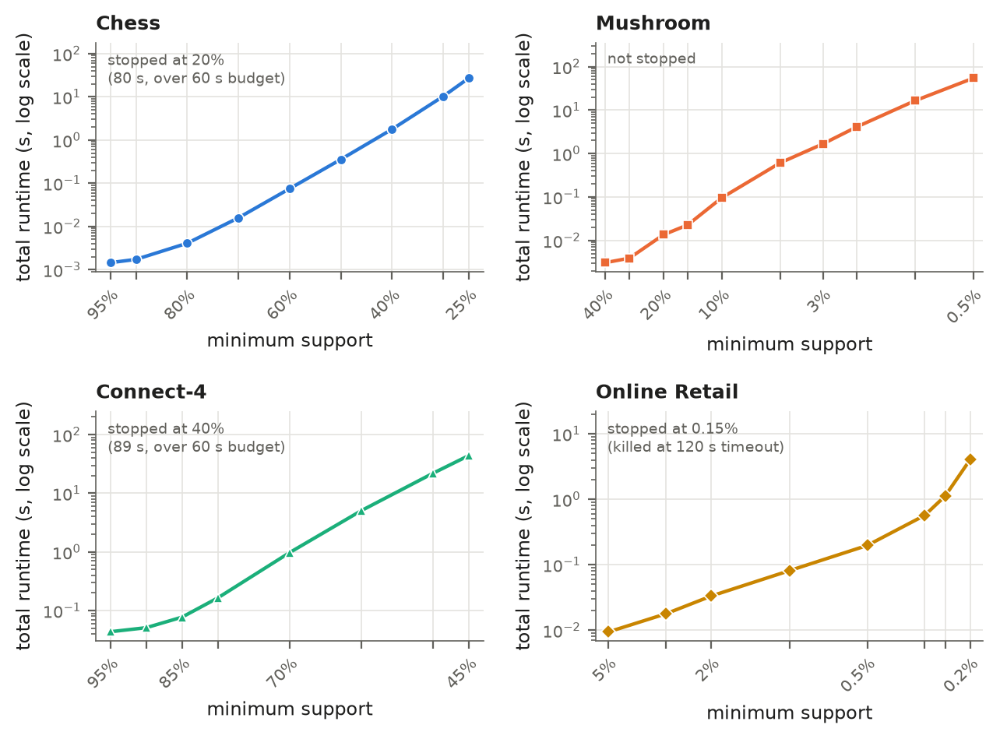
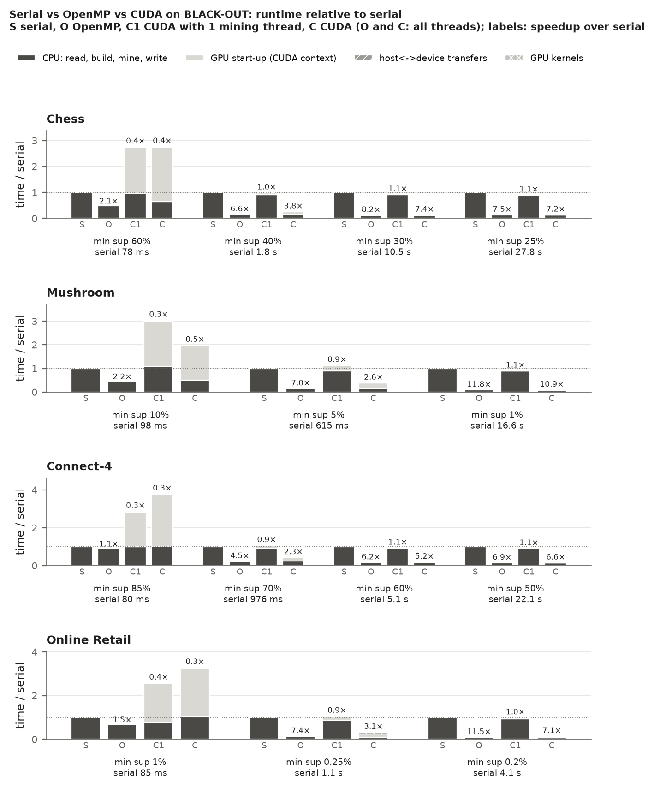

# FP-Growth frequent itemset mining in C++17, OpenMP and CUDA

An implementation of the FP-Growth frequent itemset mining algorithm in
C++17, with OpenMP and CUDA versions, benchmarked on four UCI datasets on
an RTX 4070 desktop and an NVIDIA Jetson Orin Nano.

I built it as a course project. The full write-up is in
[`report/report.pdf`](report/report.pdf) (also
[`report/report.docx`](report/report.docx), built from
[`report/report.md`](report/report.md)), and the parallel design is in
[`GPU_DESIGN.md`](GPU_DESIGN.md).

## Highlights

- **Tested for correctness** against the Han & Kamber textbook example,
  a brute-force reference (3,356 randomized runs, plus 1,354 more under
  AddressSanitizer with no sanitizer reports), six hand-written edge cases,
  and exact itemset-and-support comparisons with mlxtend on 14 settings.
- **6.3x to 29.8x faster than mlxtend's `fpgrowth()`** across 13 settings
  on the four datasets, while using far less memory (5.8 MB against
  373 MB on Chess at 60%).
- **OpenMP speedups** of 7.1x to 11.8x over the serial binary on the
  desktop (Intel i7-14700K, 28 logical CPUs), and 5.2x to 6.7x on the
  Jetson Orin Nano's six cores.
- **The GPU kernel is up to 110x faster than one CPU thread for its step,
  but gives no end-to-end gain.** That step is at most 1.8% of a serial
  run, the CUDA context costs 0.14 to 0.22 s per run on the desktop, on
  the largest trees preparing them for the GPU costs more than the copies
  and kernel together, and the deeper conditional trees are too small for
  the GPU. On the Jetson, where GPU start-up is cheaper, CUDA came within
  0.4% to 2.6% of OpenMP on the hardest settings without beating it.



*Total runtime against minimum support (log scale). Runtime follows the
number of frequent itemsets found.*



*Serial (S), OpenMP with all threads (O), and CUDA with 1 (C1) or all (C)
mining threads, relative to serial, on the RTX 4070 machine. The light
GPU start-up segment is the main difference between O and C.*

## What is in the repository

- a serial reference binary, `fpgrowth`, with built-in phase timers, peak
  memory and counters;
- tests against the Han & Kamber textbook example, a brute-force reference,
  hand-written edge cases (also under AddressSanitizer) and the mlxtend
  library;
- benchmarks on four UCI datasets (Chess, Mushroom, Connect-4, Online
  Retail), with figures and tables;
- an OpenMP version (`fpgrowth_omp`) and a CUDA + OpenMP hybrid
  (`fpgrowth_cuda`); see `GPU_DESIGN.md`.

## Requirements

- `make` and a C++17 compiler (`g++`; set `CXX` to use another)
- `python3` with `venv`; the tests, data and benchmark scripts install
  their packages (`requirements.txt`: mlxtend, pandas, openpyxl, matplotlib)
  into `.venv/` on first use
- `curl` and `gzip` for `make data`
- optional: OpenMP (`-fopenmp`) for `make omp`; the CUDA toolkit (`nvcc`)
  and an NVIDIA GPU for `make cuda` (defaults are `ARCH=sm_89` and
  `NVCC_CCBIN=g++-13`; override both to match your GPU and the host
  compilers your CUDA version supports); `pandoc` for `make report`

## Build and run

All commands below run from the repository root.

```bash
make                  # ./fpgrowth (optimised)
make debug            # ./fpgrowth_debug (AddressSanitizer)
make omp              # ./fpgrowth_omp
make cuda             # ./fpgrowth_cuda; override ARCH, NVCC, NVCC_CCBIN, e.g.
                      #   make cuda ARCH=sm_87 NVCC_CCBIN=g++   (Jetson Orin)
make gpuinfo          # ./gpuinfo: CUDA device report and a one-kernel smoke test
```

```
fpgrowth <input_file> <min_support> [output_file] [--print-tree] [--unsorted]
```

- `input_file`: FIMI format, one transaction per line, space-separated
  non-negative integer items.
- `min_support`: an absolute count (`3`) or a fraction of the transactions
  (`0.05`).
- Output: one itemset per line with its support, e.g. `1 2 5 (2)`, sorted
  by default; `--unsorted` streams itemsets as they are found.
- `--print-tree` prints the header table and the initial FP-tree.
- Timings and counters go to stderr as one line of `key=value` pairs.
- The parallel binaries also take `--threads N`; `fpgrowth_cuda` also takes
  `--gpu-min-nodes N` and `--micro-count R`.

Examples:

```bash
make run-han          # the Han & Kamber example with --print-tree
./fpgrowth data/processed/mushroom.dat 0.3 out.txt
./fpgrowth data/processed/mushroom.dat 0.3 | .venv/bin/python scripts/decode.py - data/processed/mushroom.map.tsv --top 20
./fpgrowth_omp data/processed/chess.dat 0.4 /dev/null --unsorted --threads 8
```

## Tests

```bash
make test             # edge cases and brute-force differential tests on ./fpgrowth
                      # and ./fpgrowth_debug (ASan), mlxtend check on the Han example
make test-par         # parallel binaries: edge cases, brute force, and output
                      # identical to ./fpgrowth on every dataset (needs make data)
.venv/bin/python tests/compare_mlxtend.py data/processed/chess.dat 0.6   # one dataset vs mlxtend
```

## Reproducing the results

Every number in the report comes from files in `results/`, made by these
steps. Run them one at a time on an otherwise idle machine.

```bash
make data             # download the UCI datasets into data/raw/ and convert them
                      # to data/processed/<name>.dat and <name>.map.tsv
make bench            # support sweep, scaling, itemset lengths, mlxtend timing
                      # -> results/bench.csv, scaling.csv, lengths.csv, vs_mlxtend.csv
                      # (about 20 min; resumable: delete a CSV to re-measure it)
make figures          # results/figures/*.png|pdf (incl. han_tree) and results/tables.md
make examples         # decoded example patterns -> results/examples.txt
```

Parallel and GPU results (per machine, named by host name):

```bash
make && make omp && make cuda ARCH=<your GPU arch>
python3 scripts/run_parallel_bench.py   # -> results/parallel_<host>.csv,
                                        #    gpu_threshold_<host>.csv, gpu_info_<host>.txt
python3 scripts/kernel_micro.py         # -> results/kernel_micro_<host>.csv
make figures                            # adds omp_speedup_, impl_compare_,
                                        #    gpu_threshold_, kernel_micro_<host>
```

`LAB_RUN.md` has step-by-step instructions for the lab GPU server and the
Jetson Orin. Benchmark caps and the machine used are recorded in
`results/machine.txt` and `results/gpu_info_<host>.txt`.

Finally, `make report` rebuilds `report/report.docx`. `report/report.pdf` is
exported from it with LibreOffice:
`soffice --headless --convert-to pdf --outdir report report/report.docx`.

## Repository layout

| Path | Contents |
|:-----|:---------|
| `src/fptree.h`, `src/fptree.cpp` | FP-tree: node pool with 32-bit indices, insertion, node-links, single-path test, `--print-tree` output |
| `src/fpgrowth.h`, `src/fpgrowth.cpp` | Reader, the two passes, recursive mining, output sink |
| `src/main.cpp` | Command line, phase timers, counters, peak memory |
| `src/parallel.h`, `src/parallel.cpp` | OpenMP top-level mining and merged output |
| `src/gpu.h`, `src/cuda/gpu.cu` | CUDA counting kernels |
| `src/cuda/gpuinfo.cu` | CUDA device report and smoke test |
| `tests/` | Edge cases (`edge_cases/`), brute-force differential test, mlxtend cross-check, parallel tests |
| `scripts/` | Download and preprocessing, benchmarks, figures and tables, decoding, examples |
| `data/examples/han.dat` | The Han & Kamber example |
| `data/raw/`, `data/processed/` | Downloaded and converted datasets (not in git; `make data`) |
| `results/` | Benchmark CSVs, `tables.md`, `examples.txt`, machine descriptions |
| `results/figures/` | Figures, PNG (used in the report) and PDF |
| `GPU_DESIGN.md` | Design and results of the OpenMP and CUDA versions |
| `LAB_RUN.md` | Running the parallel experiments on the lab machines |
| `report/` | `report.md` (source), `crossref.lua` (pandoc filter), `make_reference.py` (styles), `report.docx`, `report.pdf` |

## License

MIT; see [`LICENSE`](LICENSE).
