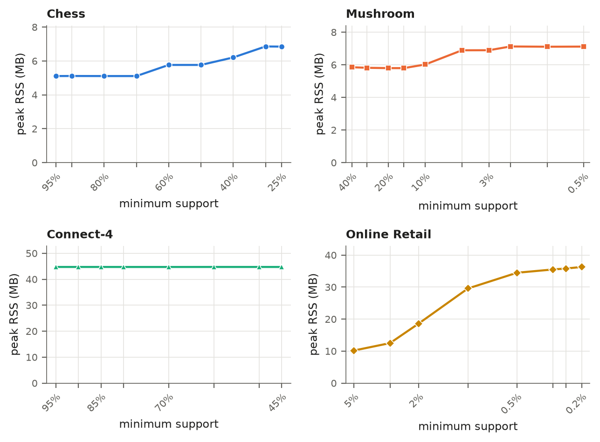
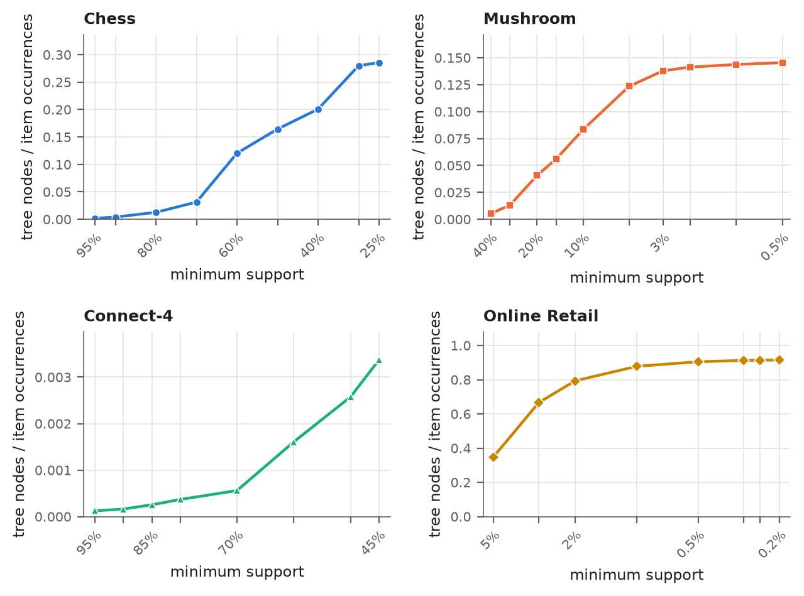
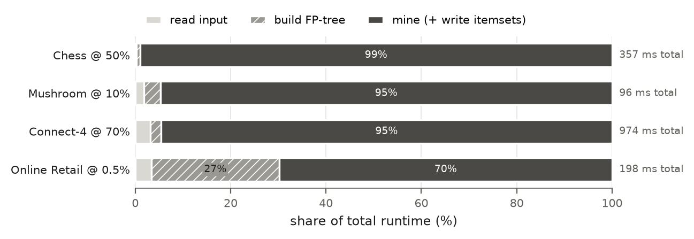
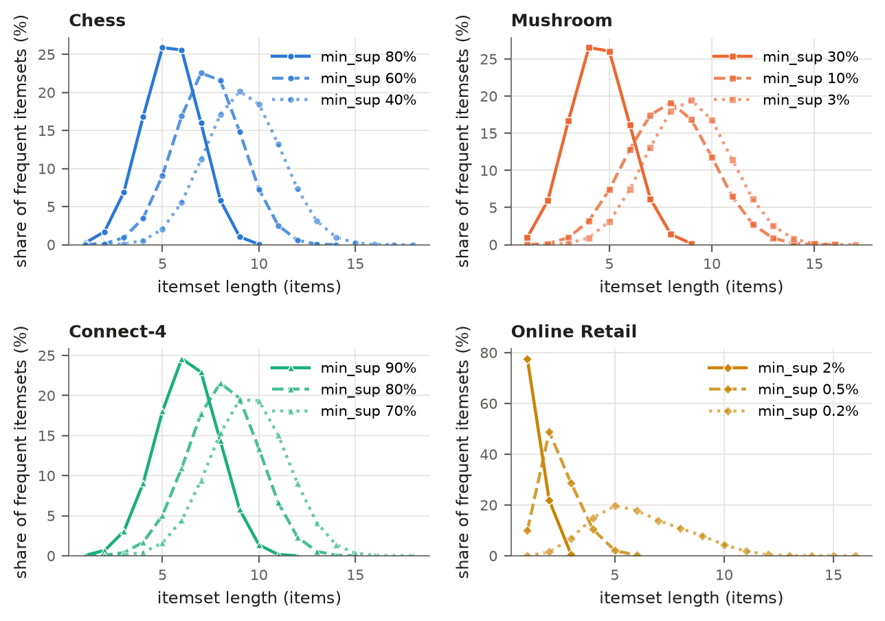
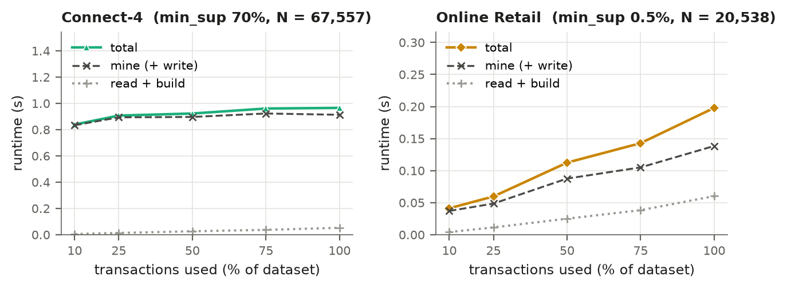

```{=openxml}
<w:p><w:r><w:br w:type="page"/></w:r></w:p>
```

# Introduction

Frequent itemset mining starts from a database of *transactions*, each a
set of *items*: the products in one shopping basket, or the attribute
values that describe one mushroom. The *support* of an itemset is the
number of transactions that contain all of its items. Given a minimum
support threshold, the task is to find every itemset whose support is at
least the threshold, together with its support. The threshold can be an
absolute count or a fraction of the transactions; my program accepts both.
Frequent itemsets are the input to association rules: the confidence of a
rule $X \Rightarrow Y$ is the support of $X \cup Y$ divided by the support
of $X$.

With $n$ distinct items there are $2^n - 1$ possible itemsets, so no
algorithm can count them all. Every practical algorithm uses the *downward
closure* property: every subset of a frequent itemset is frequent, so an
itemset with an infrequent subset can be skipped. Apriori [1] uses this
level by level. It generates candidate $k$-itemsets from the frequent
$(k-1)$-itemsets, prunes them, and scans the whole database to count the
survivors. The candidate sets can be very large, and frequent itemsets of
length 15 need at least 15 database scans.

FP-Growth [2] avoids both costs. It scans the database exactly twice to
build a compact prefix tree, the FP-tree, and then mines the tree
recursively through smaller *conditional* trees without generating any
candidates: every itemset it emits is known to be frequent.

# The FP-Growth algorithm {#sec:algo}

## The FP-tree

An FP-tree is a prefix tree over the transactions with three additions.
**Item ranks:** the frequent items are sorted by descending support, and an
item's position in that order is its rank. Each transaction is inserted as
its frequent items sorted by rank, so the most frequent items sit nearest
the root, where the most transactions can share them. **Counts:** each node
stores an item and the number of transactions whose sorted item list passes
through it. **Header table and node-links:** the header table has one entry
per frequent item, with its support and a pointer to the first node that
carries the item; each node points to the next node with the same item, so
the miner can visit every occurrence of an item without searching.

## Building the tree in two passes

**Pass 1** scans the database and counts every item. Items below the
threshold are discarded and the rest are sorted to give the ranks.
**Pass 2** scans the database again, removes the infrequent items from each
transaction, sorts the rest by rank and inserts them: from the root, it
follows the child with the next item, creating it (and linking it into the
item's node-link chain) if it does not exist, and increments the count of
every node on the path. The tree is never larger than the number of
frequent-item occurrences and is usually much smaller.

## Recursive mining

Mining goes through the header table from the least to the most frequent
item. For an item $a$ with support $s$, and a *suffix* of items fixed by
the enclosing recursion levels (empty at the top):

1. Output $\{a\} \cup$ suffix with support $s$.
2. Follow $a$'s node-links. Each node's path up to the root is a *prefix
   path* that occurs as often as the node's count. These weighted prefix
   paths form the *conditional pattern base* of $a$: the transactions that
   contain $a$, restricted to the items ranked before $a$.
3. Count the items in the pattern base, drop the infrequent ones, and build
   an FP-tree from the weighted paths: the *conditional FP-tree* of $a$.
4. Mine the conditional tree recursively with $a$ added to the suffix.

Each itemset is found exactly once, under its lowest-ranked item, because
only items ranked before $a$ appear in $a$'s pattern base. **Single-path
optimization:** if a tree is a single path, every non-empty combination of
its nodes is frequent, with the count of its deepest node as support
(counts never increase down a path). A path of $k$ nodes yields its
$2^k - 1$ itemsets directly, without building more trees.

## Complexity

The two passes take time linear in the total transaction length, plus
sorting each transaction. Mining has no useful bound in the input size,
because the output can be exponential: one path of $k$ frequent items
already produces $2^k - 1$ itemsets. The useful measure is the cost per
itemset produced. FP-Growth spends work only on itemsets that are actually
frequent, while Apriori also counts candidates that turn out infrequent.
[@sec:outbound] shows that on dense data my running time is roughly
proportional to the number of itemsets.

# Implementation {#sec:impl}

**Language and build.** The implementation is C++17 in `fptree.h/.cpp`
(the tree), `fpgrowth.h/.cpp` (input, the two passes, mining, output) and
`main.cpp` (command line). `make` builds it with `g++ -std=c++17 -O2
-DNDEBUG -Wall -Wextra -Wpedantic`; `make debug` builds a second binary with
AddressSanitizer for the tests. The edge-case tests are a shell script; the
other tests and the benchmarks are Python scripts run in a virtual
environment that the Makefile creates.
<!-- src: Makefile CXXFLAGS, DBGFLAGS; src/ file list -->

**Node pool with 32-bit indices.** All nodes of a tree live in one
`std::vector<FPNode>`, and every link (parent, first child, next sibling,
next node-link) is a 32-bit index into it, with $-1$ for "none". A node has
six 4-byte fields, so it takes 24 bytes. I chose this over pointer-linked
nodes because a tree is built once and freed all at once (one deallocation,
no leaks); a 4-byte index is half the size of a pointer and the nodes are
contiguous, which helps the cache; freeing a tree of `unique_ptr`s recurses
along every path and can overflow the stack on long transactions; and
index-based nodes map directly onto flat GPU arrays ([@sec:cuda]). During
insertion, a hash map keyed by (parent, item rank) finds children in
constant time even at a root with thousands of children; it is freed once
the tree is complete. Transactions are stored back to back in one array
with an array of start offsets (CSR layout), sorted and de-duplicated.
<!-- src: src/fptree.h FPNode (six int32/uint32 fields) and the memory-model comment; src/fpgrowth.h Dataset -->

**Item ranks and tie-break.** Items are ranked by descending support, ties
broken by ascending item id, in the initial tree and in every conditional
tree. This makes the trees, counters and output deterministic. As
[@sec:han] shows, it is also the only reason two of my conditional trees
for the textbook example are ordered differently from the book.

**Input, output and command line.**

```
fpgrowth <input_file> <min_support> [output_file] [--print-tree] [--unsorted]
```

The input is the FIMI format: one transaction per line, items as
space-separated non-negative integers; blank lines are skipped and repeated
items dropped. Each output line is an itemset and its support, such as
`1 2 5 (2)`. By default the itemsets are buffered and written in sorted
order so that runs can be compared with `diff`; `--unsorted` writes each
one as it is found. `min_support` is a count (`3`) or a fraction (`0.05`).
A fraction is rounded up to a count, unless a count matches it at the
precision it was typed: `0.266667` with 15 transactions gives 4, not 5.
`--print-tree` prints the header table and the initial tree.
<!-- src: src/main.cpp usage() and parseMinSupport() comment (0.266667, N = 15 -> 4) -->

**Instrumentation.** Each run writes one line of `key=value` pairs to
standard error: phase timers `read_s`, `build_s` (both passes), `mine_s`,
`output_s` (sorting and writing buffered output) and `total_s`; the peak
resident memory `peak_rss_kb` from `getrusage`; and counters for frequent
items, `tree_nodes`, `filtered_occurrences` (item occurrences inserted into
the tree), `itemsets`, `cond_trees` and `cond_nodes` (conditional trees
built and their nodes) and `single_paths`. With `--unsorted`, itemsets are
formatted while mining, so formatting is part of `mine_s`.

# Validation {#sec:valid}

## The Han and Kamber example {#sec:han}

The textbook example [3] has the nine transactions of [@tbl:han-data] over
items I1 to I5, mined with a minimum support count of 2. I encoded I$k$ as
the integer $k$ in `data/examples/han.dat`.
<!-- src: data/examples/han.dat; Makefile run-han (min_support 2) -->

::: {#tbl:han-data}
| TID  | Items      | TID  | Items          | TID  | Items      |
|:-----|:-----------|:-----|:---------------|:-----|:-----------|
| T100 | I1, I2, I5 | T400 | I1, I2, I4     | T700 | I1, I3     |
| T200 | I2, I4     | T500 | I1, I3         | T800 | I1, I2, I3, I5 |
| T300 | I2, I3     | T600 | I2, I3         | T900 | I1, I2, I3 |

Table: The Han and Kamber example transactions (`data/examples/han.dat`).
:::
<!-- src: data/examples/han.dat -->

`./fpgrowth data/examples/han.dat 2 --print-tree` reports the supports
I2: 7, I1: 6, I3: 6, I4: 2 and I5: 2, and a tree of 10 nodes built from 23
item occurrences, drawn in [@fig:han-tree]. The tie-break puts I1 before I3
and I4 before I5, the same header order and supports as Figure 6.7 of
[3, p. 258], and the tree has the same nodes and counts as that figure.
Only the left-to-right order of siblings and the way the node-links are
drawn differ.
<!-- src: ./fpgrowth data/examples/han.dat 2 --print-tree (header supports, tree_nodes=10, filtered_occurrences=23); compared by hand with Fig. 6.7, p. 258 of the 3rd ed. (2012) -->

{#fig:han-tree width=58%}

**Mining walkthrough.** The miner works from I5 up to I2 ([@tbl:han-walk]).

* **I5:** two nodes of count 1 with prefix paths ⟨I2, I1⟩ and ⟨I2, I1, I3⟩.
  I3 has support 1 in this base and is dropped. The conditional tree is a
  single path, so the shortcut emits {I1, I5}, {I2, I5} and {I1, I2, I5},
  each with support 2.
* **I4:** prefix paths ⟨I2, I1⟩ and ⟨I2⟩; only I2 reaches 2, giving
  {I2, I4}: 2.
* **I3:** prefix paths ⟨I2, I1⟩: 2, ⟨I2⟩: 2, ⟨I1⟩: 2, so I1 and I2 both
  have support 4. The conditional tree has two branches and is mined
  recursively: I2 in it has the prefix path ⟨I1⟩: 2, giving {I2, I3}: 4
  and {I1, I2, I3}: 2, and I1 gives {I1, I3}: 4.
* **I1:** the only prefix path is ⟨I2⟩: 4, giving {I1, I2}: 4.
* **I2:** a child of the root, so it has no pattern base.
<!-- src: ./fpgrowth data/examples/han.dat 2 --print-tree (node-links and counts); output itemsets and supports; pattern bases checked with --print-tree on each base -->

::: {#tbl:han-walk}
| Item | Conditional pattern base      | Conditional FP-tree (mine) | Itemsets generated                        |
|:--------|:------------------------------|:---------------------------|:------------------------------------------|
| I5   | {I2, I1: 1}, {I2, I1, I3: 1}  | ⟨I1:2, I2:2⟩               | {I2, I5}: 2, {I1, I5}: 2, {I1, I2, I5}: 2 |
| I4   | {I2, I1: 1}, {I2: 1}          | ⟨I2:2⟩                     | {I2, I4}: 2                               |
| I3   | {I2, I1: 2}, {I2: 2}, {I1: 2} | ⟨I1:4, I2:2⟩, ⟨I2:2⟩       | {I2, I3}: 4, {I1, I3}: 4, {I1, I2, I3}: 2 |
| I1   | {I2: 4}                       | ⟨I2:4⟩                     | {I1, I2}: 4                               |

Table: Mining the example item by item. The single items {I1}: 6, {I2}: 7, {I3}: 6, {I4}: 2 and {I5}: 2 are emitted too.
:::
<!-- src: derived from the --print-tree output; conditional trees checked by running --print-tree on each pattern base written as a dataset; stats line cond_trees=5, cond_nodes=8, single_paths=4 -->

The program's counters agree: 5 conditional trees with 8 nodes in total
(2, 1, 3 and 1 nodes for I5, I4, I3 and I1, plus the 1-node tree of I2
inside I3's tree), and 4 single paths. The output is these 13 itemsets,
the 13 frequent itemsets of the book: `1 (6)`, `1 2 (4)`, `1 2 3 (2)`,
`1 2 5 (2)`, `1 3 (4)`, `1 5 (2)`, `2 (7)`, `2 3 (4)`, `2 4 (2)`,
`2 5 (2)`, `3 (6)`, `4 (2)`, `5 (2)`.
<!-- src: output and stats line of ./fpgrowth data/examples/han.dat 2 (itemsets=13 cond_trees=5 cond_nodes=8 single_paths=4) -->

**Difference from the textbook.** Table 6.2 of [3, p. 259] lists the same
four conditional pattern bases and the same frequent patterns with the same
supports as [@tbl:han-walk]. The only difference is the item order inside
two conditional FP-trees. The book gives I3's conditional tree as
⟨I2:4, I1:2⟩ plus ⟨I1:2⟩, with I2 on top. Mine is ⟨I1:4, I2:2⟩
plus ⟨I2:2⟩, with I1 on top, because I1 and I2 tie at support 4 in I3's
pattern base and my rule puts the lower item id first. Both trees hold the
same three weighted prefix paths and yield the same itemsets {I2, I3}: 4,
{I1, I3}: 4 and {I1, I2, I3}: 2. The same tie makes my single path for I5
⟨I1:2, I2:2⟩ where the book lists ⟨I2:2, I1:2⟩, with the same itemsets. I
confirmed both trees by writing each pattern base as a small dataset and
running `--print-tree` on it, which applies the same ordering rule.
<!-- src: my trees: --print-tree on the pattern bases (I5 -> 1:2 -> 2:2; I3 -> 1:4 -> 2:2 and 2:2); itemsets from ./fpgrowth output. Book side: Table 6.2, p. 259 of the 3rd ed. (2012), checked by hand against the printed book; the book's figure and table are not reproduced here -->

## Automated tests {#sec:tests}

`make test` runs four kinds of tests, which I re-ran for this report
([@tbl:tests]). **Edge cases:** six hand-written inputs (empty file, single
transaction, identical transactions, nothing frequent, everything
frequent, and one 12-item transaction that must produce all
$2^{12} - 1 = 4095$ subsets). **Brute-force differential test:** each
trial generates a random dataset of 5 to 30 transactions over 4 to 10
items, with duplicate items, blank lines and irregular whitespace; a Python
reference computes every itemset's exact support by enumerating subsets,
and the binary must match it exactly at several absolute and fractional
thresholds. **AddressSanitizer:** the edge cases and 200 brute-force
trials also run on the ASan build, where any sanitizer report is a failure.
**mlxtend cross-check:** `tests/compare_mlxtend.py` compares itemsets and
supports exactly with mlxtend's `fpgrowth` [5]; `make test` runs it on the
Han example, and I also ran it on all 13 UCI settings of [@sec:mlxtend].
<!-- src: tests/run_edge_cases.sh, tests/edge_cases/long_transaction.expected (4095 lines), tests/brute_force.py docstring and gen_dataset(), Makefile test target -->

::: {#tbl:tests}
| Test                                       | Binary                  | Result                                         |
|:-------------------------------------------|:------------------------|:-----------------------------------------------|
| Edge cases                                 | `fpgrowth`              | 6 of 6 passed                                  |
| Edge cases                                 | `fpgrowth_debug` (ASan) | 6 of 6 passed                                  |
| Brute force, 500 datasets (seed 1)         | `fpgrowth`              | 3,356 of 3,356 runs passed                     |
| Brute force, 200 datasets (seed 2)         | `fpgrowth_debug` (ASan) | 1,354 of 1,354 runs passed, 0 sanitizer reports |
| mlxtend, Han example                       | `fpgrowth`              | 13 itemsets, identical                         |
| mlxtend, 13 settings on the 4 UCI datasets | `fpgrowth`              | 13 of 13 identical (366 to 468,003 itemsets)   |

Table: Test results from re-running `make test` and `tests/compare_mlxtend.py` for this report.
:::
<!-- src: make test output (re-run 2026-10-25); compare_mlxtend.py on the 13 settings of scripts/vs_mlxtend.py (re-run 2026-10-25, all MATCH; 366 = online_retail 0.02, 468003 = mushroom 0.1) -->

# Datasets {#sec:data}

I used four datasets from the UCI Machine Learning Repository [4]:
**Mushroom** [6] (8,124 mushrooms, 22 attributes and an edible/poisonous
class), **Chess (King-Rook vs. King-Pawn)** [7] (3,196 end-game positions,
36 board features and a win/no-win class), **Connect-4** [8] (67,557 game
positions, one attribute per each of the 42 squares and a win/loss/draw
class) and **Online Retail** [9] (invoice lines of a UK online retailer).
`make data` downloads them and converts them to FIMI files, with a
`.map.tsv` file that names every item id for decoding results.
<!-- src: data/raw/*.names (Number of Instances / Attributes); scripts/download_data.sh; scripts/preprocess.py -->

**Attribute=value encoding.** Each row of the three categorical tables
becomes one transaction with one item per attribute=value pair, such as
`odor=foul`. The class is included as an ordinary attribute, so rules that
predict it appear among the itemsets. Item ids are assigned in column
order with sorted values, so the numbering is deterministic, and missing
values (`?`) are skipped. Every row has (almost) every attribute, so all
Chess transactions have 37 items and all Connect-4 transactions 43.
<!-- src: scripts/preprocess.py categorical(); results/tables.md (Chess len 37, Connect-4 len 43) -->

**Why Mushroom has 118 items.** The Mushroom documentation lists 127
attribute values, including the two classes. Nine never occur in the
data (for example `veil-type=universal` and `stalk-root=rhizomorphs`) and
get no item id, which leaves 118. The only missing values are 2,480 `?`
entries in `stalk-root`; those rows have 22 items instead of 23.
<!-- src: scripts/preprocess.py MUSHROOM_ATTRS (127 legend values) checked against data/raw/agaricus-lepiota.data (9 absent: gill-attachment=descending/notched, gill-spacing=distant, stalk-root=cup/rhizomorphs, veil-type=universal, ring-type=cobwebby/sheathing/zone); agaricus-lepiota.names item 8 (2480 missing, stalk-root); results/tables.md (118 items, len 22-23) -->

**Online Retail cleaning.** Each invoice is a transaction of StockCodes.
Of the 541,909 raw rows, I removed 9,288 rows of cancelled invoices
(numbers starting with `C`), 1,336 further rows with quantity $\leq 0$, and
2,366 further rows that are not products: postage, carriage, fees, manual
adjustments, discounts, samples and gift vouchers (`POST`, `DOT`, `M`,
`C2`, `D`, `S`, `BANK CHARGES`, `AMAZONFEE`, `CRUK`, `PADS`, `B`,
`GIFT_*`). The remaining 528,919 rows form 20,538 invoices over 3,815
products; a product bought twice on one invoice counts once.
<!-- src: scripts/preprocess.py online_retail() and RETAIL_NON_PRODUCT; counts recomputed with the same rules from data/raw/Online Retail.xlsx: 541909 rows, 9288 cancelled, 1336 qty<=0, 2366 non-product, 528919 kept, 20538 invoices, 3815 codes -->

[@tbl:datasets] gives the statistics. *Density*, the average transaction
length divided by the number of items, separates the dense Chess (0.4933)
from the very sparse Online Retail (0.0066), whose baskets hold 1 to 1,106
items.
<!-- src: results/tables.md Datasets table -->

::: {#tbl:datasets}
| Dataset       | Transactions | Distinct items | Avg len | Min len | Max len | Density | File size |
|:--------------|-------------:|---------------:|--------:|--------:|--------:|--------:|----------:|
| Chess         |        3,196 |             75 |   37.00 |      37 |      37 |  0.4933 |  331.2 KB |
| Mushroom      |        8,124 |            118 |   22.69 |      22 |      23 |  0.1923 |  542.4 KB |
| Connect-4     |       67,557 |            129 |   43.00 |      43 |      43 |  0.3333 |    8.8 MB |
| Online Retail |       20,538 |          3,815 |   25.24 |       1 |    1106 |  0.0066 |    2.3 MB |

Table: Dataset statistics after preprocessing.
:::
<!-- src: results/tables.md "Datasets" (from results/dataset_stats.csv) -->

# Experimental results {#sec:results}

## Methodology

All serial measurements were made on an Intel Core i7-14700K (8
performance and 12 efficiency cores, 28 logical CPUs) with 15 GiB of
memory, under Ubuntu 26.04 in WSL2 on Windows, with g++ 15.2.0 and
`-std=c++17 -O2 -DNDEBUG`. The serial binary is single-threaded and runs
were made one at a time.
<!-- src: results/machine.txt -->

* Every reported value is the **median of 5 runs**, because WSL2 and the
  hybrid P/E-core scheduler add timing noise.
* All runs used **`--unsorted` with output to `/dev/null`**, so writing a
  real file does not distort time or memory. The itemsets are still fully
  formatted as text, so the **mining time includes formatting every
  itemset**.
* Every run was capped at a **4 GB address space** and a **120 s
  timeout**. A support sweep stopped at the first level that took over 60 s
  or used over 4 GB. Peak memory is the binary's own `ru_maxrss`.
<!-- src: scripts/run_bench.py (REPS=5, TIME_BUDGET_S=60, MEM_BUDGET_KB=4_000_000), scripts/benchlib.py (MEM_LIMIT_KB=4_000_000, TIMEOUT_S=120), results/machine.txt notes -->

::: {#tbl:sweep}
| Dataset       | Levels | Min support | Frequent itemsets | Total time       | Peak RSS       | Nodes / occurrences | Stopped at                  |
|:--------------|-------:|------------:|------------------:|-----------------:|---------------:|--------------------:|:----------------------------|
| Chess         |      9 |   95% – 25% |          78 – 99M | 1.45 ms – 27.4 s |   5.1 – 6.8 MB |     0.0018 – 0.2855 | 20% (run > 60 s)            |
| Mushroom      |     10 |  40% – 0.5% |        565 – 246M | 3.07 ms – 54.5 s |   5.9 – 7.1 MB |     0.0054 – 0.1454 | not reached (lowest 54.5 s) |
| Connect-4     |      8 |   95% – 45% |      2.21k – 173M | 43.6 ms – 44.1 s | 44.7 – 44.7 MB |     0.0001 – 0.0034 | 40% (run > 60 s)            |
| Online Retail |      8 |   5% – 0.2% |        33 – 5.94M |  9.4 ms – 4.07 s | 10.2 – 36.3 MB |     0.3486 – 0.9152 | 0.15% (killed at 120 s)     |

Table: Support sweep summary, from the highest to the lowest completed support level (medians of 5 runs).
:::
<!-- src: results/tables.md "Support sweep summary" -->

## Runtime and number of itemsets

[@tbl:sweep] summarizes the sweep. Runtime ([@fig:runtime]) and the number
of itemsets ([@fig:itemsets]) have nearly the same shape on every dataset.
Chess goes from 78 itemsets in 1.45 ms at 95% to 99,022,533 itemsets in
27.4 s at 25%; at 20% it found 291,225,060 itemsets in 80.4 s, over the
budget. Connect-4 reaches 173,499,179 itemsets in 44.1 s at 45%, and
Mushroom 245,818,845 in 54.5 s at 0.5%.
<!-- src: results/bench.csv chess 0.95, 0.25, 0.20 (over_time_budget, total_s 80.444209, itemsets 291225060); connect4 0.45; mushroom 0.005 -->

{#fig:runtime width=62%}

![Number of frequent itemsets (log scale) against minimum support. Notice that each panel has the same shape as the runtime panel in [@fig:runtime], except at the highest supports, where reading the input dominates the runtime: runtime follows the size of the output.](../results/figures/itemsets_vs_support.png){#fig:itemsets width=62%}

## Memory and compression

Peak memory ([@fig:memory]) stays between 5.1 and 7.1 MB on Chess and
Mushroom at every level, even with 246 million itemsets. Connect-4 uses
44.7 MB at every level, and Online Retail grows from 10.2 MB at 5% to
36.3 MB at 0.2%.
<!-- src: results/bench.csv peak_rss_kb: chess 5232..7020, mushroom 5936..7296 (KB/1024 = 5.1..7.1 MB), connect4 45796..45808, online_retail 10424..37168; results/tables.md ranges -->

{#fig:memory width=62%}

[@fig:compression] shows the initial tree's size divided by the number of
item occurrences inserted into it (1 would mean no prefix sharing). On
Connect-4 it is 0.0001 to 0.0034: at 95%, 1,127,478 occurrences are stored
in 140 nodes. On Online Retail it climbs from 0.3486 at 5% to 0.9152 at
0.2%, where the tree has only about 8% fewer nodes than occurrences and is
almost one separate path per basket. The ratio rises as the support falls
because the newly admitted rarer items appear in few transactions and start
new branches instead of extending shared prefixes.
<!-- src: results/tables.md compression column; results/bench.csv connect4 0.95 (tree_nodes 140, filtered_occurrences 1127478), online_retail 0.002 (0.9152) -->

{#fig:compression width=62%}

## Phase breakdown and itemset lengths

At a mid-range support per dataset ([@fig:phases]), mining takes 99% of the
time on Chess at 50% and about 95% on Mushroom at 10% and Connect-4 at 70%.
On Online Retail at 0.5%, building the tree takes 27% and mining 70%,
because the tree has 398,233 nodes but only 15,143 itemsets come out. At
very high support the balance reverses: on Chess at 95%, reading the file
is 75% of a 1.45 ms run.
<!-- src: results/bench.csv, shares = phase / (read_s + build_s + mine_s): chess 0.5 mine 99.0%; mushroom 0.1 mine 94.7%; connect4 0.7 mine 94.6%; online_retail 0.005 build 26.8%, mine 69.8%, tree_nodes 398233, itemsets 15143; chess 0.95 read 74.8% -->

{#fig:phases width=72%}

Lowering the support shifts the itemsets to longer lengths
([@fig:lengths]). On Chess the most common length is 5 at 80% (25.9% of
itemsets), 7 at 60% and 9 at 40%, where the longest itemset has 18 items.
On Online Retail at 2%, 77.6% of the itemsets are single items and the
longest has 3; at 0.2% the most common length is 5 and the longest is 16.
<!-- src: results/lengths.csv chess 0.8 len 5 0.258904, chess 0.6 len 7 (0.225457), chess 0.4 len 9 (0.201306) max len 18; online_retail 0.02 len1 0.775956 max len 3; online_retail 0.002 len 5 (0.196646) max len 16 -->

{#fig:lengths width=62%}

## Scalability in the number of transactions

I shuffled Connect-4 and Online Retail once (seed 327), took the first 10,
25, 50, 75 and 100% of the transactions as nested subsets, and mined each
at a fixed *relative* support: 70% and 0.5% ([@fig:scaling]). On
Connect-4, read and build time grow linearly from 5.2 ms to 52.5 ms, but
mining stays between 0.834 s and 0.923 s, because the itemset count barely
changes (3,797,583 on 10%, 4,129,839 on 100%). On Online Retail, total time
grows from 0.041 s to 0.198 s although the itemsets *fall* from 60,331 to
15,143; [@sec:relsup] explains why.
<!-- src: scripts/run_scaling.py (SEED=327, FRACTIONS, SUPPORT); results/scaling.csv connect4 0.1 (read 0.002707 + build 0.002448 = 5.2 ms; mine 0.833552; itemsets 3797583), connect4 1.0 (read 0.030406 + build 0.022105 = 52.5 ms; mine 0.912986; itemsets 4129839), connect4 0.75 mine 0.922902 (max); online_retail 0.1 (total 0.041267, itemsets 60331), 1.0 (total 0.197898, itemsets 15143) -->

{#fig:scaling width=72%}

## Comparison with mlxtend {#sec:mlxtend}

I compared my program with the `fpgrowth` function of mlxtend [5] 0.25.0
on 13 settings ([@fig:mlxtend]; medians of 3 runs). My time is the total,
including reading the file, building the tree, mining and formatting every
itemset. **mlxtend's time is only the `fpgrowth()` call** on an already
one-hot-encoded DataFrame; reading and encoding are excluded. Mine was
faster in all 13 settings, by 6.3× to 11.3× on the dense datasets and
23.6× to 29.8× on Online Retail, and on Chess at 60% it peaked at 5.8 MB
against 373 MB for the mlxtend process. My program is single-threaded;
mlxtend averaged about 1.25 CPU-seconds per wall-second and gave similar
times when forced to one thread, so the gap is not a threading effect.
<!-- src: results/tables.md "Runtime vs mlxtend" (speedups 6.3x..11.3x dense, 23.6x..29.8x retail; threading note); results/machine.txt (mlxtend 0.25.0; median of 3); results/vs_mlxtend.csv chess 0.6 binary_peak_rss_kb 5900 (= 5.8 MB), mlxtend_peak_rss_kb 381524 (= 372.6 MB) -->

{#fig:mlxtend width=72%}

# Discussion {#sec:disc}

## Dense versus sparse data

On the dense datasets every transaction contains a large share of all
items, so transactions share long prefixes and the tree is tiny:
Connect-4's 67,557 transactions fit in 1,081 nodes at 70%. The itemsets,
however, are many and long. Online Retail is the opposite: baskets share
few prefixes, so the tree is almost as large as the data (398,233 nodes for
440,101 occurrences at 0.5%), but few itemsets are frequent until the
threshold is very low. That is why tree building matters only on Online
Retail ([@fig:phases]).
<!-- src: results/bench.csv connect4 0.7 (tree_nodes 1081, transactions 67557); online_retail 0.005 (tree_nodes 398233, filtered_occurrences 440101) -->

## Mining is output-bound {#sec:outbound}

On the dense datasets the mining time per itemset is nearly constant: 275
to 282 ns on Chess from 80% to 25%, 194 to 222 ns on Mushroom from 10% to
0.5%, and 210 to 254 ns on Connect-4 from 90% to 45%, while the itemset
count changes by 2.7 (Mushroom) to 4.1 (Chess) orders of magnitude. A `perf` profile of Connect-4
at 70% put about 75% of all samples in the C++ standard library,
formatting itemsets. Conditional trees are a minor cost: they average only
3 to 7 nodes on the dense datasets (`cond_nodes / cond_trees`).
<!-- src: results/bench.csv mine_s / itemsets: chess 0.8..0.25 = 275..282 ns; mushroom 0.1..0.005 = 194..222 ns; connect4 0.9..0.45 = 210..254 ns; avg cond tree size chess 3.1..4.2, mushroom 3.5..7.2, connect4 3.7..6.3; GPU_DESIGN.md section 1 (perf, ~75% in libstdc++) -->

## Memory is flat because output is streamed

With `--unsorted`, each itemset is written as soon as it is found, and the
recursion holds only the small conditional trees on the current path, so
memory is set by the input and the initial tree. Connect-4's 44.7 MB does
not change at all while its tree grows from 140 to 7,586 nodes, so it is
the cost of reading and storing the 8.8 MB input. Online Retail's memory
follows its initial tree, which grows from 14,846 to 454,641 nodes. In the
default sorted mode all itemsets are buffered before sorting, so memory
would grow with the output; the benchmarks avoid that on purpose.
<!-- src: results/bench.csv peak_rss_kb; connect4 tree_nodes 140 (95%) .. 7586 (45%); results/tables.md Connect-4 file size 8.8 MB; online_retail tree_nodes 14846 (5%) .. 454641 (0.2%); src/fpgrowth.cpp ItemsetSink buffering -->

## The Online Retail explosion below 0.2%

From 5% to 0.5% the itemsets grow only from 33 to 15,143. Going from 0.25%
to 0.2% multiplies them by almost ten, from 596,206 to 5,944,725 (runtime
1.12 s to 4.07 s), and at 0.15% the run hit the 120 s timeout. At 0.2% (a
minimum count of 41 invoices) the longest frequent itemset has 16 items:
16 products that appear together on at least 41 invoices. By downward
closure all $2^{16} - 1 = 65{,}535$ non-empty subsets of such a group are
frequent too, so once long groups like this appear, the output explodes.
<!-- src: results/bench.csv online_retail 0.05 (33), 0.005 (15143), 0.0025 (596206, 1.124035 s), 0.002 (5944725, 4.072353 s, min_count 41), 0.0015 timeout; results/lengths.csv online_retail 0.002 max length 16 -->

## Why Online Retail gets slower on less data {#sec:relsup}

In the scaling experiment, the 10% subset of Online Retail produced 60,331
itemsets and the full dataset 15,143. The cause is the relative support:
0.5% of the subset's 2,054 transactions is a minimum count of only 10
invoices, against 103 on the full data, and far more product groups are
bought together 10 times than 103 times. A fixed relative threshold on a
small sample of sparse data therefore asks a different question. Runtime
still grows with the data because the tree grows from 41,534 to 398,233
nodes. Connect-4 shows no such effect because its frequent items are very
common attribute values whose relative frequency barely changes between
subsets.
<!-- src: results/scaling.csv online_retail 0.1 (transactions 2054, min_count 10, itemsets 60331, tree_nodes 41534) and 1.0 (min_count 103, itemsets 15143, tree_nodes 398233) -->

## Example patterns

I decoded some itemsets with the item-name files (`scripts/examples.py`,
output in `results/examples.txt`).

**Mushroom: odor predicts the class.** Mining the Mushroom data restricted
to the odor and class items shows that every odor except `none` determines
the class. All 2,160 mushrooms with `odor=foul` are poisonous, and all 400
with `odor=almond` and all 400 with `odor=anise` are edible. Odorless
mushrooms are mostly edible (3,408 of 3,528, confidence 0.966). Odor alone
classifies 4,596 of the 8,124 mushrooms without error.
<!-- src: results/examples.txt Mushroom table (foul 2160/2160 poisonous; almond 400, anise 400 edible; none 3408/3528 edible conf 0.966); 4596 = 8124 - 3528 -->

**Online Retail: the teacup rule.** The shop sells a "Regency teacup and
saucer" in green, pink and roses designs. At 1% support, {GREEN, PINK}
appears on 633 invoices and {GREEN, PINK, ROSES} on 542, so the rule
{GREEN, PINK} $\Rightarrow$ {ROSES} has confidence 542 / 633 = 0.856,
although only 1,066 of the 20,538 invoices (0.052) contain the roses cup. A
customer who buys two colors is very likely to buy the third: a typical
recommendation rule.
<!-- src: results/examples.txt Online Retail section (633, 542, conf 0.856, 1066 / 20538 = 0.052) -->

# Parallel and GPU implementation {#sec:par}

For the bonus I built `fpgrowth_omp` (OpenMP) and `fpgrowth_cuda` (CUDA plus
OpenMP) from the same sources. Their host code uses the same compiler and
flags as the serial binary and only the CUDA kernels go through `nvcc`, so
speed differences come from the parallelization.
<!-- src: GPU_DESIGN.md intro; Makefile comment -->

## OpenMP version {#sec:omp}

The top-level loop over the frequent items of the initial tree consists of
independent subproblems that share only the read-only initial tree. It runs
as `#pragma omp for schedule(dynamic, 1)`, rarest item first, since rare
items have the largest conditional trees and the work per item varies by
orders of magnitude. Each thread has its own result sink. In sorted mode
the threads' buffers are sorted in parallel and k-way merged, which gives
output byte-identical to the serial binary's. With `--unsorted`, each thread
formats into a private 1 MB buffer that is written out in whole lines under
a lock, so formatting, the dominant cost, also runs in parallel.
<!-- src: GPU_DESIGN.md section 2; src/parallel.cpp (schedule(dynamic, 1), LineChunkBuf 1 << 20) -->

**Limit: only the top level is split**, so the most expensive single item's
subtree bounds the mining time from below. The dense datasets scale almost
linearly to 4 threads, then, except Mushroom at 1%, gain little from 8 to
28 ([@fig:omp]). This is
most likely that critical path, combined with the CPU's mix of 8
hyper-threaded performance cores and 12 slower efficiency cores. Online
Retail, with about 2,000 top-level items, keeps scaling. Splitting deeper
recursion levels into tasks would be the next step.
<!-- src: GPU_DESIGN.md section 2 "Limit of this design"; results/bench.csv online_retail frequent_items 2000 (0.3%) .. 2325 (0.2%) -->

**The false-sharing bug.** In my first version, each thread's sink and
stream buffer were separate small heap allocations whose counters and
write pointer change on every itemset. Whether two threads' objects shared
a cache line depended on the heap layout, which even the length of the
command-line paths changed. With a bad layout, 2 threads on Connect-4 at
50% took 17 to 19 s instead of 10 s. I fixed it by putting each thread's
output state into one object aligned to 128 bytes, and re-ran the affected
benchmark.
<!-- src: GPU_DESIGN.md section 2 (17-19 s vs 10 s); src/parallel.cpp struct alignas(128) ThreadOut -->

**The `--unsorted` buffering confound.** The parallel binaries hand
`--unsorted` output over in 1 MB chunks, while the serial binary writes
through `std::ofstream`'s much smaller buffer. That alone makes
`fpgrowth_omp --threads 1` up to 10% faster than `fpgrowth` on the dense
datasets: Connect-4 at 60% mines in 4.54 s against 5.04 s. With sorted
output the two are within 2%. The OpenMP speedups in [@fig:omp] are
therefore relative to the 1-thread OpenMP run.
<!-- src: GPU_DESIGN.md section 2 caveat; results/parallel_BLACK-OUT.csv connect4 0.6 omp_t1 mine_s 4.542267, serial mine_s 5.037507 -->

## CUDA hybrid version {#sec:cuda}

Two facts decided what goes to the GPU: mining is output-bound
([@sec:outbound]), and conditional trees are tiny (on average 3 to 7 nodes
on the dense datasets and on average at most about 150 on Online
Retail). A CUDA context
costs about 0.15 s to create, and one GPU round trip tens of microseconds.
So only the regular, data-parallel counting steps go to the GPU:
<!-- src: GPU_DESIGN.md section 1 (~0.15 s context, tens of microseconds); results/bench.csv cond_nodes/cond_trees (dense 3.1..7.2, online_retail 149.1 at 0.5%) -->

* **Pass 1, item counting:** one thread per item occurrence rather than per
  transaction (Online Retail transactions have 1 to 1,106 items, and one
  long transaction would stall its warp), counting into a shared-memory
  histogram per block, because global atomics on the dense datasets' only 75
  to 129 distinct items would collide constantly.
* **Conditional-support counting:** the first step of building item $r$'s
  conditional tree walks every node of $r$ up to the root, adding its count
  to each ancestor's item. For all items at once this is a regular
  reduction. The tree is flattened into arrays; one block handles one item
  and one thread one node, adding into a row in shared memory. The result
  is a lower-triangular matrix holding every frequent 2-itemset and the
  first step of every conditional tree. The initial tree always goes to the
  GPU, a conditional tree only if it has at least `--gpu-min-nodes` nodes
  (default 4,096).
<!-- src: GPU_DESIGN.md section 3 (pass 1, conditional-support counting, default 4096); src/main.cpp kDefaultGpuMinNodes = 4096 -->

::: {#tbl:cpugpu}
| Part                               | Why it stays on the CPU                                                        |
|:-----------------------------------|:-------------------------------------------------------------------------------|
| Reading the file                   | I/O and text parsing |
| Tree insertion (pass 2)            | Sequential pointer chasing and hashing with contention near the root; trees of at most 455k nodes build in 30 to 70 ms |
| Recursion over conditional trees   | A few nodes per tree; a kernel launch costs more than the work |
| Single-path enumeration and output | About 75% of serial mining time is text formatting; the text must end up on the host, and copying gigabytes over PCIe would cost about as much as it saves |

Table: What stays on the CPU in `fpgrowth_cuda`, and why (from `GPU_DESIGN.md`).
:::
<!-- src: GPU_DESIGN.md section 3 "What stays on the CPU, and why" and "Pass 2" (455k nodes, 30-70 ms) -->

**Choosing the threshold.** With one mining thread ([@fig:gputhresh]),
offloading small trees is a large loss: at a threshold of 64, Online Retail
at 0.25% counts 10,182 trees on the GPU and mines 59% slower than with the
initial tree alone. At 4,096 it counts 323 trees there (the initial tree
and 322 conditional trees) and mines in 0.984 s against 1.042 s, a 5.5%
gain. On Chess at 40% no setting helps.
<!-- src: results/gpu_threshold_BLACK-OUT.csv online_retail 0.0025: gpu_min_nodes 64 mine_s 1.658004 (gpu_trees 10182), 4096 mine_s 0.984365 (323), 1e9 mine_s 1.041799; 1.658004/1.041799 = 1.59, 0.984365/1.041799 = 0.945; chess 0.4 rows -->

{#fig:gputhresh width=70%}

## Correctness of the parallel versions {#sec:partests}

`make test-par` runs the edge cases at several thread counts, the
brute-force test, and a comparison with `./fpgrowth` on every dataset at 2
support levels (identical sorted output, the same `--unsorted` lines, and
matching counters). `fpgrowth_cuda` also runs with `--gpu-min-nodes 0` (64
on Online Retail) so the GPU path handles far more trees. My re-run
for this report passed every check: 6 of 6 edge cases in each of 7
configurations, all 3,619 brute-force runs (2,683 for `fpgrowth_omp`, 936
for `fpgrowth_cuda`) and 32 of 32 dataset comparisons. An earlier run had 3
failures in the `fpgrowth_cuda` brute-force runs. In each,
`cudaSetDevice` failed with "CUDA-capable device(s) is/are busy or
unavailable" and the program exited before reading any data, so no wrong
output was produced; replaying the three failed cases gave the correct
output. I did not identify the cause.
<!-- src: tests/run_parallel_tests.sh; make test-par output, first run 2026-10-25 (3 FAIL, cudaSetDevice busy; tests/failures/trial0013_sup2, trial0036_sup0p100000000, trial0099_sup0p464285714, info.txt exit 1, empty actual.txt) and re-run 2026-10-25 (test-par: all passed; brute force omp 2010 + 673 = 2683, cuda 667 + 269 = 936, total 3619; 32 dataset PASS lines); replay 2026-10-26 of the 3 cases with ./fpgrowth_cuda (default and --gpu-min-nodes 0 --threads 4): exit 0, output = expected.txt -->

## Results on the RTX 4070 machine

The parallel benchmarks ran on the same machine with an NVIDIA GeForce RTX
4070 (sm_89, 46 SMs, 12 GiB) and CUDA 12.4, as medians of 5 runs with
`--unsorted` output to `/dev/null`, each capped at 120 s and 3.8 GiB
resident memory ([@tbl:par]).
<!-- src: results/gpu_info_BLACK-OUT.txt (RTX 4070, sm_89, 46 SMs, 12.0 GiB, CUDA 12.4, 3.8 GiB RSS cap, 120 s); GPU_DESIGN.md section 5 (median of 5) -->

::: {#tbl:par}
| Dataset       | Min sup | Itemsets   | Serial | OMP 1  | OMP 4 | OMP 8     | OMP 28    | CUDA 1 | CUDA 28 |
|:--------------|--------:|-----------:|-------:|-------:|------:|----------:|----------:|-------:|--------:|
| Chess         |     30% | 37,282,962 | 10.466 |  9.485 | 2.409 |     1.335 | **1.271** |  9.673 |   1.417 |
| Chess         |     25% | 99,022,533 | 27.771 | 25.786 | 6.411 | **3.445** |     3.724 | 25.226 |   3.862 |
| Mushroom      |      5% |  3,082,813 |  0.615 |  0.553 | 0.156 |     0.101 | **0.088** |  0.699 |   0.239 |
| Mushroom      |      1% | 77,322,009 | 16.596 | 14.862 | 3.789 |     2.038 | **1.410** | 14.983 |   1.521 |
| Connect-4     |     60% | 21,252,795 |  5.102 |  4.606 | 1.276 | **0.772** |     0.828 |  4.787 |   0.984 |
| Connect-4     |     50% | 88,316,367 | 22.061 | 19.872 | 5.123 | **3.096** |     3.183 | 20.171 |   3.350 |
| Online Retail |   0.25% |    596,206 |  1.137 |  1.114 | 0.340 |     0.209 | **0.154** |  1.215 |   0.370 |
| Online Retail |    0.2% |  5,944,725 |  4.084 |  3.927 | 1.064 |     0.580 | **0.354** |  4.051 |   0.576 |

Table: Total time in seconds on the RTX 4070 machine, the two hardest levels per dataset (median of 5). OMP *n*: `fpgrowth_omp` with *n* threads; CUDA *n*: `fpgrowth_cuda` with *n* mining threads. Bold: fastest.
:::
<!-- src: results/parallel_BLACK-OUT.csv total_s for configs serial, omp_t1, omp_t4, omp_t8, omp_tall, cuda_t1, cuda_tall -->

**OpenMP is the win.** The best speedups over the serial binary are 8.2×
(Chess 30%), 11.8× (Mushroom 1%), 7.1× (Connect-4 50%) and 11.5× (Online
Retail 0.2%). Above about 0.5 s of runtime, scaling is close to linear up
to 4 threads (3.3 to 4.0× over the 1-thread run). Below about 0.1 s,
thread start-up and the serial read and build phases dominate, and 28
threads are slower than 8.
<!-- src: GPU_DESIGN.md section 6; results/parallel_BLACK-OUT.csv: 10.466/1.271 = 8.24, 16.596/1.410 = 11.77, 22.061/3.096 = 7.13, 4.084/0.354 = 11.54; omp_t1/omp_t4 3.28..4.02 -->

{#fig:omp width=62%}

**CUDA never beats OpenMP on this machine** ([@fig:impl]). On the larger
settings, CUDA with 28 threads is 0.11 to 0.22 s slower than OpenMP with
28, about the cost of creating the CUDA context (0.14 to 0.22 s), and on
the smallest setting of each dataset that start-up alone makes the CUDA
binary 2 to 3.8 times slower than serial. The GPU work itself is small: on
the dense datasets the kernels take 1.5 to 4.3 ms and transfers at most
1.2 ms per run. Only Online Retail at 0.25% and 0.2% (322 and 469
conditional trees) and Chess at 30% and 25% (5 and 8) send conditional
trees to the GPU, and with 28 threads sharing it, Online Retail at 0.2%
takes 0.576 s against 0.354 s for OpenMP alone.
<!-- src: GPU_DESIGN.md section 6 (0.11-0.22 s, gpu_init_s 0.14-0.22 s, 2-3.8x slower); results/parallel_BLACK-OUT.csv cuda rows: count_kernel_s + tree_kernel_s 1.54..4.29 ms, transfers 0.17..1.18 ms on chess/mushroom/connect4; gpu_cond_trees online_retail 322, 469, chess 0.3 5, 0.25 8; online_retail 0.002 cuda_tall 0.576, omp_tall 0.354 -->

{#fig:impl width=100%}

## Kernel level: where the GPU does win

To check whether the kernel itself is fast, `fpgrowth_cuda --micro-count 5`
times only the step it replaces, the conditional supports of every item of
the *initial* tree, on one CPU thread and on the GPU, in one process after
the CUDA context exists and after a warm-up, and checks that both results
are equal ([@fig:kernel]).
<!-- src: GPU_DESIGN.md "Kernel level"; src/main.cpp microCount(); scripts/kernel_micro.py (median of 5) -->


On trees above a few thousand nodes the GPU wins clearly: 9 to 110 times
for the kernel alone and 4 to 38 times with the copies, mostly growing
with tree size (the largest tree gains 83 and 32 times, less than the
297k-node one). On the largest tree (Online Retail 0.2%, 454,641 nodes) the CPU needs
73.5 ms, the kernel 0.88 ms, the kernel with transfers 2.3 ms, and the
whole GPU path 9.0 ms. The GPU wins because the work is thousands of independent upward walks with all
atomics in shared memory. On the 411-node Connect-4 tree the launch latency
(about 25 µs) exceeds the CPU's 8 µs. Sub-millisecond kernel times vary
between runs: the Online Retail 0.2% kernel measured 0.56 ms in an earlier
run.
<!-- src: GPU_DESIGN.md "Kernel level" (9-110x, 4-39x, 0.56 ms earlier run); results/kernel_micro_BLACK-OUT.csv online_retail 0.002 (tree_nodes 454641, cpu_s 0.0735, gpu_kernel_s 0.000884, gpu_kernel_xfer_s 0.00231, gpu_wall_s 0.00898), connect4 0.85 gpu_kernel_s 0.000024992, cpu_s 0.000008184 -->

{#fig:kernel width=90%}

Four reasons keep this from becoming an end-to-end speedup:

1. **The step is a tiny part of the run.** Its largest instance, 73.5 ms
   on Online Retail at 0.2%, is 1.8% of the 4.08 s serial run; on Chess at
   25% it is 1.7 ms of 27.8 s.
2. **Fixed costs exceed the saving.** The CUDA context costs 0.14 to 0.22 s
   per run, more than the best saving (73.5 ms down to 9.0 ms). On the
   large trees, flattening 455k nodes and unpacking the 2.7-million-entry
   matrix on the CPU take about 6.9 ms, three times the copies and kernel
   together.
3. **Against OpenMP the CPU work is not serial.** In `fpgrowth_omp` each
   item's counting runs inside its own task, spread over all threads. The
   GPU call for the initial tree runs once, before the parallel loop, on
   the critical path: 9 ms of wall time, while 73.5 ms of CPU work spread
   over 28 threads costs only a few milliseconds.
4. **Deeper trees are too small.** The remaining counting happens in
   conditional trees averaging 3 to 7 nodes on the dense datasets and on
   average at most about 150 on Online Retail, where the GPU loses even on the kernel
   alone, as the 411-node tree shows.
<!-- src: GPU_DESIGN.md "Why none of this shows up end to end"; results/kernel_micro_BLACK-OUT.csv online_retail 0.002 (cpu_s 0.0735, gpu_wall_s 0.00898, gpu_prep_s 0.006876 = 6.9 ms, gpu_kernel_xfer_s 0.00231, matrix_entries 2701650), chess 0.25 cpu_s 0.00169; results/parallel_BLACK-OUT.csv online_retail 0.002 serial 4.084, chess 0.25 serial 27.771; results/bench.csv cond_nodes/cond_trees (online_retail per-level averages 1.0..149.1, max at 0.5%) -->

The GPU kernel is fast, but it accelerates a small fraction of FP-Growth's
runtime on these datasets, which is dominated by irregular, output-heavy
CPU work. A multi-core CPU is the better parallel target here. The GPU
would matter more with much larger initial trees, from many more
transactions or items at a support where conditional trees stay large.

## Results on the Jetson Orin Nano {#sec:jetson}

The lab results come from an NVIDIA Jetson Orin Nano (board CAD02 in room
281; its hostname is `localhost`, so its result files are named
`jetson-orin`). `make test-par` passed on this board for both
`fpgrowth_omp` and `fpgrowth_cuda`: all edge cases, all 3,619 brute-force
runs and 32 of 32 dataset comparisons. A second Jetson board (CAD06) gave
nearly identical timings on the runs it completed, for example 7.013 s
against 7.012 s for serial Chess at 40%.
<!-- src: results/gpu_info_jetson-orin.txt (Jetson Orin Nano, collected 2026-10-29); make test-par output on CAD02 (all passed, 3619 brute-force runs, 32 dataset PASS lines); CAD06 7.013 s read from the CAD06 terminal output during a partial run that was not saved to the repo; results/parallel_jetson-orin.csv chess 0.4 serial total_s 7.011943 -->

The Jetson is a much smaller machine ([@tbl:hw]): six Arm cores instead
of 28 logical CPUs, and a GPU with 8 SMs instead of 46 that has no memory
of its own but shares the board's 7.4 GiB with the CPU. It ran in its
25 W power mode. The benchmarks are the same as on the RTX 4070 machine,
as medians of 3 runs (5 for the kernel micro-benchmark), each capped at
120 s and 2.9 GiB resident memory. The script picks the support levels
from the serial runtimes in `results/bench.csv`. The Jetson rows have 3
runs each and cover only the first three runtime targets, which is what
the script's `--quick` mode produces, so Chess and Connect-4 have three
levels instead of four. All 12 levels were also run on the RTX 4070
machine. On these 12 levels the serial
binary is 2.9 to 4.2 times slower on the Jetson.
<!-- src: results/gpu_info_jetson-orin.txt (6 logical CPUs, Cortex-A78AE, 7.4 GiB, 2.9 GiB RSS cap, 120 s, "NV Power Mode: 25W", Orin sm_87, 8 SMs, "integrated, shared with CPU"); results/gpu_info_BLACK-OUT.txt (28 logical CPUs, RTX 4070, 46 SMs, 12.0 GiB); results/parallel_jetson-orin.csv reps 3, 12 levels (chess 0.6 0.4 0.3, mushroom 0.1 0.05 0.01, connect4 0.85 0.7 0.6, online_retail 0.01 0.0025 0.002), all present in results/parallel_BLACK-OUT.csv; results/kernel_micro_jetson-orin.csv reps 5; scripts/run_parallel_bench.py pick_levels() (bench.csv total_s), TARGETS_S [0.1, 1, 10, 25], --quick = TARGETS_S[:3] and 3 reps; serial total_s Jetson/RTX 2.95 (online_retail 0.0025) to 4.17 (online_retail 0.01) -->

::: {#tbl:hw}
| | RTX 4070 machine | Jetson Orin Nano (CAD02) |
|:--|:--|:--|
| CPU | Intel Core i7-14700K, 28 logical CPUs | 6 Arm Cortex-A78AE cores, 1 thread each, up to 1,728 MHz |
| Memory | 15.6 GiB | 7.4 GiB, shared by CPU and GPU |
| GPU | GeForce RTX 4070, sm_89, 46 SMs, 36 MiB L2 | Orin (integrated), sm_87, 8 SMs, 4 MiB L2 |
| GPU memory | 12.0 GiB, separate (discrete card) | the same 7.4 GiB as the CPU |
| Power | not recorded | 25 W mode (`nvpmodel`) |
| Software | Ubuntu 26.04 under WSL2, g++ 15.2, CUDA 12.4 | Ubuntu 24.04, g++ 13.3, CUDA 13.2 |
| Runs per median, memory cap | 5, 3.8 GiB | 3, 2.9 GiB |

Table: The two machines that ran the parallel benchmarks (from the `gpu_info` files).
:::
<!-- src: results/gpu_info_BLACK-OUT.txt and results/gpu_info_jetson-orin.txt (CPU, logical CPUs, lscpu threads per core / CPU max MHz, RAM, GPU, compute capability, SMs, L2 36864 KiB / 4096 KiB, global memory, OS, kernel WSL2 / tegra, g++, nvcc, nvpmodel, RSS caps); results/parallel_*.csv reps -->

::: {#tbl:jetson}
| Dataset       | Min sup | Itemsets   | Serial | OMP 1  | OMP 2  | OMP 4  | OMP 6      | CUDA 1 | CUDA 6 |
|:--------------|--------:|-----------:|-------:|-------:|-------:|-------:|-----------:|-------:|-------:|
| Chess         |     60% |    254,944 |  0.283 |  0.260 |  0.138 |  0.077 |  **0.063** |  0.325 |  0.123 |
| Chess         |     40% |  6,472,980 |  7.012 |  6.289 |  3.182 |  1.607 |  **1.231** |  6.446 |  1.302 |
| Chess         |     30% | 37,282,962 | 40.902 | 36.454 | 18.323 |  9.265 |  **6.718** | 36.966 |  6.744 |
| Mushroom      |     10% |    468,003 |  0.385 |  0.337 |  0.178 |  0.121 |  **0.107** |  0.399 |  0.170 |
| Mushroom      |      5% |  3,082,813 |  2.515 |  2.187 |  1.101 |  0.615 |  **0.454** |  2.255 |  0.518 |
| Mushroom      |      1% | 77,322,009 | 68.925 | 59.640 | 29.862 | 15.072 | **10.223** | 59.938 | 10.345 |
| Connect-4     |     85% |    142,271 |  0.253 |  0.240 |  0.191 |  0.165 |  **0.160** |  0.301 |  0.217 |
| Connect-4     |     70% |  4,129,839 |  3.887 |  3.410 |  1.781 |  0.996 |  **0.711** |  3.490 |  0.776 |
| Connect-4     |     60% | 21,252,795 | 20.827 | 18.117 |  9.147 |  4.713 |  **3.361** | 18.242 |  3.403 |
| Online Retail |      1% |      1,860 |  0.354 |  0.356 |  0.293 |  0.254 |  **0.247** |  0.355 |  0.326 |
| Online Retail |   0.25% |    596,206 |  3.354 |  3.316 |  1.896 |  1.154 |  **0.903** |  3.195 |  0.965 |
| Online Retail |    0.2% |  5,944,725 | 12.440 | 11.979 |  6.338 |  3.374 |  **2.400** | 11.951 |  2.462 |

Table: Total time in seconds on the Jetson Orin Nano (median of 3). OMP *n*: `fpgrowth_omp` with *n* threads; CUDA *n*: `fpgrowth_cuda` with *n* mining threads. Bold: fastest.
:::
<!-- src: results/parallel_jetson-orin.csv itemsets and total_s for configs serial, omp_t1, omp_t2, omp_t4, omp_tall (6 threads), cuda_t1, cuda_tall (6 threads) -->

**OpenMP scales well on six cores** ([@fig:omp-jetson]). On the dense
datasets, wherever one thread takes more than 2 s, 4 threads are 3.4 to
4.0 times faster than one and 6 threads 4.8 to 5.8 times. Unlike on the
RTX 4070 machine, the curves have not flattened at the last step: going
from 4 to 6 threads still gains 1.31 to 1.47 times on these runs (1.5
would be linear). The best speedups over the serial binary are 6.1×
(Chess 30%), 6.7× (Mushroom 1%), 6.2× (Connect-4 60%) and 5.2× (Online
Retail 0.2%). They can exceed 6 because of the `--unsorted` buffering
confound described in [@sec:omp]: on the Jetson the 1-thread OpenMP run is
up to 13.5% faster than the serial binary. Connect-4 at 85% and Online
Retail at 1% (0.24 and 0.36 s on one thread) gain only 1.5 and 1.4 times
from 6 threads, because reading and building, which are serial, take 0.135
and 0.220 s of that time. In absolute terms, the Jetson's best OpenMP time on
the hardest level of each dataset is 4.4 to 7.3 times the RTX 4070
machine's best time at the same level.
<!-- src: results/parallel_jetson-orin.csv total_s: omp_t1/omp_t4 chess 0.4 3.91, 0.3 3.93, mushroom 0.05 3.56, 0.01 3.96, connect4 0.7 3.42, 0.6 3.84; omp_t1/omp_tall same levels 5.11, 5.43, 4.82, 5.83, 4.79, 5.39; omp_t4/omp_tall 1.31, 1.38, 1.35, 1.47, 1.40, 1.40; serial/omp_tall chess 0.3 40.902/6.718 = 6.09, mushroom 0.01 68.925/10.223 = 6.74, connect4 0.6 20.827/3.361 = 6.20, online_retail 0.002 12.440/2.400 = 5.18; 1 - omp_t1/serial -0.005 (online_retail 0.01) to 0.135 (mushroom 0.01); omp_t1/omp_tall connect4 0.85 1.50, online_retail 0.01 1.44; omp_t1 read_s + build_s connect4 0.85 0.135 of 0.240, online_retail 0.01 0.220 of 0.356; Jetson omp_tall / best RTX OpenMP (results/parallel_BLACK-OUT.csv min of omp_t4, omp_t8, omp_tall): chess 0.3 6.718/1.271 = 5.29, mushroom 0.01 10.223/1.410 = 7.25, connect4 0.6 3.361/0.772 = 4.36, online_retail 0.002 2.400/0.354 = 6.78 -->

{#fig:omp-jetson width=62%}

**CUDA comes close to OpenMP but still does not beat it**
([@fig:impl-jetson]). With all six threads, `fpgrowth_cuda` is slower
than `fpgrowth_omp` at every level, by 0.026 to 0.122 s; on the hardest
level of each dataset this is only 0.4% to 2.6%, against 0.11 to 0.23 s
on the RTX 4070 machine. On the smallest level of each dataset CUDA with
6 threads takes 1.3 to 1.9 times as long as OpenMP, but it is still
faster than the serial binary at every level; on the RTX 4070 machine
it was 2 to 3.8 times slower than serial at these smallest levels. With one mining
thread, CUDA beats OpenMP on Online Retail at 0.25% (3.195 s against
3.316 s, 3.6% faster), the level where 322 conditional trees go to the
GPU, and matches it at 0.2% (11.951 s against 11.979 s).
<!-- src: results/parallel_jetson-orin.csv total_s cuda_tall - omp_tall 0.026 (chess 0.3) to 0.122 (mushroom 0.01); cuda_tall/omp_tall chess 0.3 1.004, mushroom 0.01 1.012, connect4 0.6 1.013, online_retail 0.002 1.026; results/parallel_BLACK-OUT.csv cuda_tall - omp_tall 0.111..0.231 over all 14 levels; smallest levels chess 0.6 1.95, mushroom 0.1 1.59, connect4 0.85 1.36, online_retail 0.01 1.32; serial/cuda_tall >= 1.09 (online_retail 0.01 0.354/0.326); online_retail 0.0025 cuda_t1 3.195 vs omp_t1 3.316 (gpu_cond_trees 322), 0.002 cuda_t1 11.951 vs omp_t1 11.979 (gpu_cond_trees 469); RTX figures from the Results on the RTX 4070 machine section -->

**GPU start-up is about a third as expensive.** Creating the CUDA
context (`gpu_init_s`) takes 0.054 to 0.061 s on the Jetson in all 24
CUDA runs, against 0.139 to 0.218 s on the RTX 4070 machine, while the CPU
work around it is 2.9 to 4.2 times slower. The start-up cost is therefore
clearly visible only on the smallest level of each dataset. The two
machines differ in GPU type, CUDA version and operating system (the RTX
4070 machine runs under WSL2), and I did not isolate which of these
causes the difference.
<!-- src: results/parallel_jetson-orin.csv gpu_init_s min 0.0543 max 0.0609 over cuda_t1 and cuda_tall rows (12 levels x 2); results/parallel_BLACK-OUT.csv gpu_init_s min 0.1385 max 0.2182; results/gpu_info_*.txt (CUDA 13.2 / 12.4, WSL2 kernel) -->

![Total time relative to serial on the Jetson Orin Nano for serial (S), OpenMP with 6 threads (O), and CUDA with 1 (C1) or 6 (C) mining threads, split as in [@fig:impl]. Notice that the light start-up segment is clearly visible only at the smallest level of each dataset, and that C is within 3% of O at the hardest level of each dataset.](../results/figures/impl_compare_jetson-orin.png){#fig:impl-jetson width=100%}

**The offload threshold matters less on the Jetson** ([@fig:gputhresh-jetson]).
With one mining thread, a threshold of 64 makes mining only 1.1% slower
on Online Retail at 0.25% and 2.3% slower on Chess at 40%, against 59%
and 17% on the RTX 4070 machine. The fastest setting on Online Retail is
1,024 (947 trees on the GPU): 2.644 s against 2.879 s with only the
initial tree on the GPU, 8.2% faster. The default of 4,096 gains 5.1%
(5.5% on the RTX 4070 machine, where 1,024 gains 1.9%). On Chess at 40%
every threshold from 1,024 up is within 0.4% of counting only the
initial tree on the GPU, on both machines. At a threshold of 64 on Online Retail, flattening, copies and
kernels add up to 0.437 s on the Jetson against 0.625 s on the RTX 4070
machine, while mining with the initial tree alone on the GPU takes 2.8
times as long (2.879 s against 1.042 s), so offloading small trees costs
a much smaller share of the run.
<!-- src: results/gpu_threshold_jetson-orin.csv online_retail 0.0025 mine_s: 64 2.910927 (10182 trees), 1024 2.644137 (947), 4096 2.731958 (323), 1e9 2.879181; 2.910927/2.879181 = 1.011, 2.644137/2.879181 = 0.918, 2.731958/2.879181 = 0.949; chess 0.4 64 6.528994 / 1e9 6.381581 = 1.023, 1024..16384 within 0.3%; tree_prep_s + tree_h2d_s + tree_kernel_s + tree_d2h_s at 64: 0.128123 + 0.095248 + 0.167853 + 0.045983 = 0.437; results/gpu_threshold_BLACK-OUT.csv online_retail 0.0025 64 1.658004/1.041799 = 1.59, 1024 1.021526/1.041799 = 0.981, 4096 0.984365/1.041799 = 0.945, at 64: 0.038742 + 0.054430 + 0.317558 + 0.214016 = 0.625; chess 0.4 64 1.941120/1.654133 = 1.17, 1024..16384 within 0.4%; mining 2.879/1.042 = 2.76 -->

{#fig:gputhresh-jetson width=70%}

**At kernel level the GPU still wins, by less** ([@fig:kernel-jetson]).
On trees above a few thousand nodes the kernel alone is 2.4 to 52 times
faster than one CPU thread (9 to 110 times on the RTX 4070). On the
largest tree (Online Retail 0.2%) the CPU needs 233.6 ms, the kernel
6.86 ms (34×), the kernel with transfers 7.55 ms (31×) and the whole GPU
path 52.8 ms (4.4×, against 8.2× on the RTX 4070 machine). On the
411-node Connect-4 tree the Jetson's kernel (17.7 µs) is faster than its
CPU (26.8 µs), where the RTX 4070 lost (25.0 µs against 8.2 µs), but
with the copies it loses too (34.9 µs). On Chess and Mushroom the kernel
takes 0.43 to 0.50 ms for trees of 10.8k to 31.8k nodes, much more
relative to tree size than the 0.045 ms of the 5.7k-node Connect-4 tree
at 50%. I did not investigate the cause.
<!-- src: results/kernel_micro_jetson-orin.csv speedup_kernel 2.36 (chess 0.6) to 52.37 (online_retail 0.01) on all but connect4 0.85; online_retail 0.002 cpu_s 0.2335725, gpu_kernel_s 0.006859, speedup_kernel 34.05, gpu_kernel_xfer_s 0.007546 (30.95), gpu_wall_s 0.052830 (4.42); connect4 0.85 cpu_s 0.000026842, gpu_kernel_s 0.000017664, gpu_kernel_xfer_s 0.000034880; gpu_kernel_s chess 0.6 0.000465, 0.25 0.000504, mushroom 0.1 0.000429, 0.01 0.000441 (tree_nodes 10844..31813), connect4 0.5 0.0000446 (5715); results/kernel_micro_BLACK-OUT.csv speedup_kernel 9.17..109.70, online_retail 0.002 speedup_wall 8.18, connect4 0.85 gpu_kernel_s 0.000024992, cpu_s 0.000008184 -->

**Transfers cost less, but not nothing.** `fpgrowth_cuda` copies with
`cudaMemcpyAsync` on both machines; on the Jetson the source and
destination are in the same memory, not in a separate GPU memory. The copies
add 5% to 12% to the kernel time on Chess, Mushroom and Online Retail,
against 104% to 191% on the RTX 4070 machine (all trees), and on the
largest tree take 0.69 ms against 1.43 ms. They are not free, though:
on the Connect-4 trees they add 50% and 97%, and in the full runs the
pass-1 copy of the Connect-4 transactions takes 1.7 ms on the Jetson
against 1.0 ms on the RTX 4070 machine.
<!-- src: src/cuda/gpu.cu cudaMemcpyAsync (lines 219, 234, 308, 327); results/gpu_info_jetson-orin.txt "integrated, shared with CPU"; results/kernel_micro_jetson-orin.csv (gpu_kernel_xfer_s - gpu_kernel_s)/gpu_kernel_s: chess 0.05, 0.08, mushroom 0.07, 0.09, online_retail 0.12, 0.10, connect4 0.97 (0.85), 0.50 (0.5); online_retail 0.002 0.000687 s; results/kernel_micro_BLACK-OUT.csv same ratio 1.04..1.91, online_retail 0.002 0.001426 s; results/parallel_jetson-orin.csv connect4 count_h2d_s 0.00169..0.00177; results/parallel_BLACK-OUT.csv connect4 count_h2d_s 0.00100..0.00109 -->

**CPU-side preparation dominates the GPU path even more.** Flattening the
tree and unpacking the result on the CPU take 45.2 ms of the 52.8 ms GPU
path on Online Retail at 0.2% (86%) and 92% at 1%, against 77% and 81%
on the RTX 4070 machine (6.9 of 9.0 ms at 0.2%). On Chess at 25% and
Mushroom at 1% the share is 44.5% to 48.9% on both machines. On the
Jetson this preparation, not the kernel, is the largest part of the GPU
path on the large Online Retail trees. As on the RTX 4070 machine, the whole step is a small part of
the run: 233.6 ms of the 12.44 s serial run on Online Retail at 0.2%
(1.9%).
<!-- src: results/kernel_micro_jetson-orin.csv gpu_prep_s/gpu_wall_s online_retail 0.002 0.045249/0.052830 = 85.7%, 0.01 0.026526/0.028972 = 91.6%, chess 0.25 46.6%, mushroom 0.01 44.5%; results/kernel_micro_BLACK-OUT.csv online_retail 0.002 0.006876/0.008981 = 76.6%, 0.01 80.6%, chess 0.25 47.4%, mushroom 0.01 48.9%; results/parallel_jetson-orin.csv online_retail 0.002 serial total_s 12.440; 0.2336/12.440 = 1.9% -->

{#fig:kernel-jetson width=90%}

The Jetson confirms the conclusion from the RTX 4070 machine: OpenMP
gives the speedup, at best 5.2 to 6.7 times on six cores, and the GPU
does not add to it. Mostly because of the smaller start-up cost, CUDA
comes within 0.4% to 2.6% of OpenMP on the hardest levels, but the work the GPU can take over is
still a few percent of the run.
<!-- src: results/parallel_jetson-orin.csv serial/omp_tall on the hardest level of each dataset 5.18..6.74; cuda_tall/omp_tall 1.004..1.026 on those levels; results/kernel_micro_jetson-orin.csv online_retail 0.002 (1.9% of serial) -->

# Conclusion

I implemented FP-Growth in C++17 with an index-based node pool,
deterministic item ranks, and built-in timers and counters. It reproduces
the Han and Kamber tree and all 13 itemsets (two conditional trees differ
only in order, because of my tie-break), and it passed 3,356 brute-force
runs, 1,354 more under AddressSanitizer, six edge cases and exact mlxtend
comparisons on 14 settings.
<!-- src: make test output (3356, 1354, 6 edge cases); 14 = Han example + 13 UCI settings with compare_mlxtend.py; han.dat output (13 itemsets) -->

The experiments show that FP-Growth's cost follows its output. On dense
data the tree compresses the input by up to four orders of magnitude and
memory stays flat (5.1 to 7.1 MB on Chess and Mushroom, 44.7 MB on
Connect-4), while the runtime grows with the number of itemsets at a
nearly constant 194 to 282 ns each. On the sparse Online
Retail data the tree barely compresses and the output explodes below 0.2%
support. My implementation was 6.3 to 29.8 times faster than mlxtend's
`fpgrowth()` call. OpenMP over the top-level items gave speedups of 7.1 to
11.8 times on 28 logical CPUs. The CUDA kernel is up to 110 times faster
than the CPU for its step, but gives no end-to-end gain because that step
is a few percent of the runtime. On the 6-core Jetson Orin Nano, OpenMP
gave best speedups of 5.2 to 6.7 times, and with a cheaper GPU start-up
(0.054 to 0.061 s) and mostly cheaper copies CUDA came within 0.4% to 2.6% of OpenMP on the hardest
levels without beating it, so the conclusion is the same. Splitting
deeper recursion levels across threads would be the next improvement.
<!-- src: make test output (3356, 1354, 6); 14 mlxtend settings = Han + 13 UCI; results/tables.md (compression 0.0001 on Connect-4; mlxtend 6.3x-29.8x); results/bench.csv ns per itemset (194-282 ns), peak_rss_kb chess/mushroom 5232..7296, connect4 45796..45808; GPU_DESIGN.md section 6 (7.1x-11.8x); results/kernel_micro_BLACK-OUT.csv (110x); Jetson numbers from the Jetson section: results/parallel_jetson-orin.csv serial/omp_tall 5.18..6.74 on the hardest levels, gpu_init_s 0.0543..0.0609, cuda_tall/omp_tall 1.004..1.026 on the hardest levels; results/kernel_micro_jetson-orin.csv transfers -->

# References {-}

[1] R. Agrawal and R. Srikant, "Fast algorithms for mining association
rules," in *Proc. 20th Int. Conf. on Very Large Data Bases (VLDB)*, 1994,
pp. 487–499.

[2] J. Han, J. Pei, and Y. Yin, "Mining frequent patterns without
candidate generation," in *Proc. ACM SIGMOD Int. Conf. on Management of
Data*, Dallas, TX, 2000, pp. 1–12.

[3] J. Han, M. Kamber, and J. Pei, *Data Mining: Concepts and Techniques*,
3rd ed. Morgan Kaufmann, 2012.

[4] Markelle Kelly, Rachel Longjohn, Kolby Nottingham, The UCI Machine
Learning Repository, https://archive.ics.uci.edu

[5] S. Raschka, "MLxtend: Providing machine learning and data science
utilities and extensions to Python's scientific computing stack," *Journal
of Open Source Software*, vol. 3, no. 24, p. 638, 2018. Version 0.25.0
used.

[6] "Mushroom," UCI Machine Learning Repository, 1981. [Online].
Available: https://doi.org/10.24432/C5959T. Records drawn from *The
Audubon Society Field Guide to North American Mushrooms*, G. H. Lincoff
(Pres.), New York: Alfred A. Knopf, 1981, pp. 500–525, as given in the
dataset's `agaricus-lepiota.names` file.

[7] A. Shapiro. "Chess (King-Rook vs. King-Pawn)," UCI Machine Learning
Repository, 1983. [Online]. Available: https://doi.org/10.24432/C5DK5C.

[8] J. Tromp. "Connect-4," UCI Machine Learning Repository, 1995.
[Online]. Available: https://doi.org/10.24432/C59P43.

[9] D. Chen. "Online Retail," UCI Machine Learning Repository, 2015.
[Online]. Available: https://doi.org/10.24432/C5BW33.

# Appendix: Building, running and repository layout {-}

Build requirements, instructions for every program and `make` target, the
repository layout and the steps to reproduce every result in this report
are in `README.md` at the top level of the submitted zip file.
